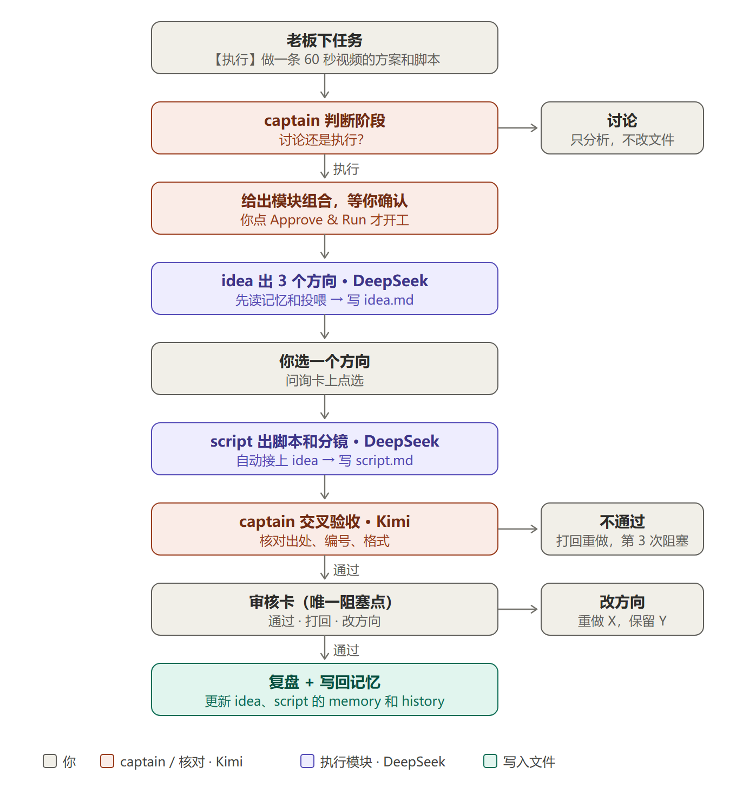
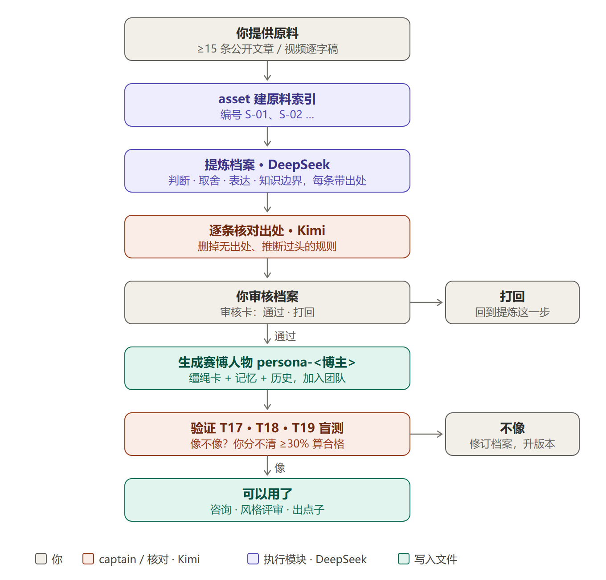

# 技术实现文档 v1.0

| 项目 | 内容 |
|---|---|
| 产品 | AI 协作创作工作台（PRD v1.6） |
| 本文回答 | PRD 里每个需求**用什么实现、配在哪、文件怎么流转、按什么顺序落地** |
| 日期 | 2026-11-12 |
| 运行环境 | 第一阶段：本机 Windows 11；第二阶段：Mac mini（另议） |
| 状态标记 | ✅ 已核实 / 已完成　🔧 待配置　🛠 需开发　⚠️ 未核实，以实机为准 |

> 本文所有「已核实」均来自 2026-11-11 至 11-12 对 npm、GitHub README 与本机 `dsh --dump-config` 的实际查询；未核实项集中在第 11 节。

## 1. 总体架构

### 1.1 分层

| 层 | 组成 | 职责 |
|---|---|---|
| 入口层 | DSH Web UI（`127.0.0.1:3080`）；P1 飞书插件；dsh-cron 定时 | 接收老板指令与触发 |
| 编排层 | AgentTeams 的 captain（= 当前 DSH 会话） | 阶段闸门、选模块、派活、交叉验收、复盘写回 |
| 模块层 | AgentTeams 成员：idea / script / edit / asset / design / advocate / persona-* | 各自产出交付物 |
| 数据层 | `workspace/`（投喂、素材、模块记忆、任务目录、复盘） | 唯一真相源，全部是本地 Markdown 文件 |
| 运行时 | DSH 0.2.1-rc.2 + 插件；Node 24；模型 API（DeepSeek / Kimi） | 执行与模型调用 |

### 1.2 运行时视图

```
dsh web（一个 Node 进程，profile = web）
 ├─ Web UI :3080（带访问令牌）
 ├─ captain 会话  ← 老板在 UI 中对话；会话所选模型 = 验收模型（Kimi）
 │    └─ AgentTeams（插件 @nanmicoder/dsh-agent-teams）
 │         ├─ 团队 profile：video / single（定义在 cordis.patch.yml）
 │         ├─ 成员子会话 idea / script / …（memberModel = 执行模型 DeepSeek）
 │         └─ 状态目录 .agent-teams（任务依赖图、消息、归档）
 ├─ 工具（按 agent 启用）：tool-fs、tool-fs-search、tool-pwsh（Windows）、tool-web、tool-ask-user、tool-schedule …
 └─ 权限预设：read-only / workspace-write（默认）/ danger-full-access
```

关键事实（✅ 已核实）：

- DSH 的数据目录是 `C:\Users\25370\.dsh`；本项目使用独立的 `profiles\web`，**不影响**你已有的 `desktop`、`headless` 两个 profile；
- web profile 的配置补丁文件是 `C:\Users\25370\.dsh\profiles\web\cordis.patch.yml`（当前为空数组 `[]`）；
- Windows 下 DSH 用 `tool-pwsh` 执行命令，`tool-bash` 被禁用；
- 默认权限模式 `workspace-write`：沙箱只允许写工作目录，越界操作走审批（`approval: ask`）；
- AgentTeams 成员只在一个团队任务内可续聊，任务结束团队归档 → 长期记忆必须落在文件里（FR-10 的实现前提）。

## 2. 环境与部署

### 2.1 本机已完成（2026-11-11）

| 项 | 结果 | 位置 |
|---|---|---|
| fnm | 1.39.0（winget 安装） | `%LOCALAPPDATA%\Microsoft\WinGet\Packages\Schniz.fnm_*` |
| Node.js | 24.22.3（fnm 管理，与原 `D:\node` v22 并存） | `C:\Users\25370\.fnm` |
| PowerShell 配置 | 新开 PowerShell 自动启用 Node 24 | `E:\系统文档\文档\WindowsPowerShell\Microsoft.PowerShell_profile.ps1` |
| pnpm | 12.18.0（DSH 管理插件需要） | Node 24 全局 |
| DSH | 0.2.1-rc.2（安装时放行了 5 个依赖的安装脚本） | Node 24 全局 |
| AgentTeams | 0.1.29 | `~\.dsh\profiles\web` |
| 模型 Key | ❌ 尚未填写 | Web UI → Settings → Models |

### 2.2 启动与常用命令

```
dsh web                     # 启动 Web UI，终端会打印带 token 的访问地址
dsh web --no-open           # 不自动开浏览器
dsh plugin --profile web list
dsh plugin --profile web add --save-exact <包名>@<版本>
dsh web --dump-config       # 查看合成后的完整配置（排查用）
```

注意：

- 必须在**新开的 PowerShell** 里运行（这样才走 Node 24）；
- 不要在 Claude 应用的沙箱里长期运行 DSH：沙箱会把 AppData 写入重定向到应用私有目录。DSH 自身数据在 `~\.dsh` 不受影响，但 npm、pnpm 缓存会被重定向；
- 访问地址里的 token 等同于登录凭据，不要外发。

### 2.3 待安装插件（按落地顺序）

| 顺序 | 插件 | 用途 | 何时装 |
|---|---|---|---|
| 1 | `@nanmicoder/dsh-agent-teams@0.1.29` | 团队编排 | ✅ 已装 |
| 2 | `github:Vincent-chk/dsh-ponytail` | 最小必要规则 | 第一条链路跑通后 |
| 3 | `@aiwayds/dsh-cron` | 定时触发 | 第一条链路跑通后 |
| 4 | `@aiwayds/dsh-feishu` | 飞书入口与审核卡 | P1 |

原则：一次只加一个插件，加完重跑已通过的测试，出问题能立刻定位。

## 3. 配置实现

### 3.1 配置文件分工

| 文件 | 内容 | 改后生效 |
|---|---|---|
| `~\.dsh\profiles\web\cordis.patch.yml` | AgentTeams（成员模型、toolPolicies、团队 profile）、Ponytail 档位、飞书、cron | 通常热更新；不生效则重启 `dsh web` |
| `workspace\modules\<模块>\persona.md` | 模块缰绳卡 | 下次任务读取即生效 |
| `workspace\config\*.md` | 触发规则、状态与审核规范 | 由 captain 协议引用，下次任务生效 |
| Web UI → Settings → Models | 模型 Key 与路由 | 立即生效 |

### 3.2 cordis.patch.yml 落地版（第一条链路用）

第一条链路只启用 idea、script 和 captain，其余成员等链路跑通再加。`<WORKSPACE>` 在本机替换为 `E:/reabook/workspace`。

```
- id: agent-teams
  config:
    memberModel: <执行模型 id，DeepSeek>        # ⚠️ 填 Settings → Models 中显示的模型 id
    profiles:
      chain1:
        description: 第一条链路：idea → script，captain 交叉验收
        taskPlanning: seed
        protocol: >
          先读 E:/reabook/workspace/modules/captain/persona.md 并严格遵守。
          讨论阶段只分析不改文件；执行阶段先说明模块组合与验证方式，老板确认后再派活。
          默认唯一审核节点在成品前；永不自动通过。红线任何阶段都单独确认。
          输出开头标注 6 种状态之一。执行模块不自评；由你验收并写回记忆。
        members:
          - name: idea
            role: 创意方案。开工前先读 E:/reabook/workspace/modules/idea/ 下 persona.md、memory.md、history.md。
          - name: script
            role: 脚本与分镜。开工前先读 E:/reabook/workspace/modules/script/ 下三份文件。
        tasks:
          - id: idea
            subject: 创意方案（projects/<任务ID>/idea.md）
            assignee: idea
          - id: script
            subject: 脚本与分镜（projects/<任务ID>/script.md）
            assignee: script
            dependencies: [idea]
```

完整版（video / single 两个 profile、advocate、赛博人物、Ponytail、飞书）见 `workspace\config\cordis.patch.example.yml`。

### 3.3 模型路由（交叉验收的实现）

| 角色 | 模型 | 配置方式 |
|---|---|---|
| captain（验收） | Kimi | 启动团队前，在 captain 会话里选 Kimi 模型 |
| 执行模块 | DeepSeek | `memberModel` |
| advocate、赛博人物做风格评审 | Kimi | 成员行 `model` |

AgentTeams 规则（✅ README）：成员与 captain 同路由时继承推理档位；换了 provider 或 model 则用目标模型的默认档位。

### 3.4 权限与文件边界

| 边界 | 实现 | 强度 |
|---|---|---|
| 只能写 workspace | 在 Web UI 把会话工作目录设为 `E:\reabook\workspace`，权限预设用 `workspace-write`（沙箱只放行工作目录写入） | 硬约束 ✅ |
| 模块只写自己的文件 | 缰绳卡「边界」一节 + captain 验收时检查 | 软约束（靠模型遵守） |
| advocate 只读 | toolPolicies 隐藏写工具 | ⚠️ 需确认模型侧工具名后才能写 allow 列表 |
| 红线操作 | 权限预设 `approval: ask` + 缰绳卡兜底 | 硬约束 + 软约束 |

## 4. PRD 需求 → 实现映射

| FR | 实现方式 | 主要文件 / 配置 | 状态 |
|---|---|---|---|
| FR-1 模块选择 | captain 协议的阶段闸门与路由表；AgentTeams「先审批再运行」 | `modules/captain/persona.md`；profile `protocol` | 🔧 |
| FR-2 多模块协作 | AgentTeams 任务依赖（`dependencies`）；交付物写入 `projects/<任务ID>/` | profile `tasks` | 🔧 |
| FR-3 四类投喂 | Markdown 文件 + 编号规范；缰绳卡要求标注编号 | `feeds/` | 🔧 规范已有，内容为空 |
| FR-4 审核 | captain 在成品前调用 `tool-ask-user` 弹问询卡：通过 / 打回 / 改方向 | `config/status-and-review.md` | 🔧 |
| FR-5 素材管理 | asset 建索引；时长、尺寸需要读媒体信息 | `modules/asset/` | 🛠 需媒体信息脚本 |
| FR-6 治理与复盘 | captain 复盘写入 `reviews/流程复盘/` | 复盘模板 | 🔧 |
| FR-7 告警 | 飞书插件 `backgroundPush` | P1 | 🔧 |
| FR-8 反调官 | advocate 成员 + 触发词 | `modules/advocate/` | 🔧 |
| FR-9 Ponytail | Ponytail 插件 `defaultMode: full` | P1 | 🔧 |
| FR-10 模块记忆 | 文件记忆；开工读、复盘时由 captain 写 | `modules/*/memory.md`、`history.md` | 🔧 / 🛠 需校验脚本 |
| FR-11 触发 | dsh-cron（定时）；AgentTeams 依赖（上游完成）；自带 schedule（一次性提醒） | `config/triggers.md` | 🔧 |
| FR-12 状态与审核 | 输出标记约定 + AgentTeams 活动面板（预览、接管）+ 问询卡 | `config/status-and-review.md` | 🔧 |
| FR-13 交叉验收 | 会话模型与 memberModel 分属两家；验收结论写明两侧模型 | 3.3 节 | 🔧 |
| FR-14 赛博人物 | 蒸馏档案 + persona 成员 | `feeds/thinking/`、`modules/_赛博人物模板/` | 🔧 / 🛠 需逐字稿 |

## 5. 数据与文件规范

### 5.1 目录

```
E:\reabook\workspace\
├── feeds\  sources\<博主ID>\ · thinking\ · style\ · types\
├── assets\           原始素材，只读；_index.md 由 asset 维护
├── modules\<模块>\    persona.md · memory.md · history.md
├── projects\<任务ID>\ idea.md · script.md · assets.md · edit\ · design\
├── reviews\          流程复盘\ · 数据复盘\ · _复盘模板.md
├── config\           triggers.md · status-and-review.md · cordis.patch.example.yml
├── TODO.md · known-pitfalls.md
└── _archive\         旧结构，只读
```

### 5.2 编号规则

| 对象 | 格式 | 例 | 分配者 |
|---|---|---|---|
| 任务 | `P<三位>` | P001 | captain |
| 素材 | `A-<四位>` | A-0012 | asset |
| 类型投喂 | `TY-<两位>` | TY-03 | 老板 / captain |
| 风格投喂 | `S-<两位>` | S-02 | 老板 / captain |
| 思维投喂与蒸馏档案 | `T-<博主ID>-<两位>`、`P-…`、`E-…` | T-luo-04 | 蒸馏流程 |
| 蒸馏原料 | `S-<两位>`（在博主目录内） | S-07 | asset |
| 模块记忆 | `M-<两位>`（模块内唯一） | M-03 | captain |

编号一经分配不再变更；删除的编号不复用。

### 5.3 写入权矩阵

| 文件 | 写入者 | 其他模块 |
|---|---|---|
| `projects/<任务ID>/idea.md` | idea | 只读 |
| `projects/<任务ID>/script.md` | script | 只读 |
| `projects/<任务ID>/assets.md`、`assets/_index.md` | asset | 只读 |
| `projects/<任务ID>/edit/` | edit | 只读 |
| `projects/<任务ID>/design/` | design | 只读 |
| `modules/*/memory.md`、`history.md` | **只有 captain** | 本模块只读 |
| `reviews/`、`TODO.md`、`known-pitfalls.md` | captain | 只读 |
| `feeds/`、`assets/` 原始文件 | 老板（captain 可代写档案草稿，须经审核） | 只读 |

## 6. 核心流程时序

### 6.1 第一条链路（idea → script）



文字版（便于搜索和复制）：

```
老板 → captain：「【执行】为 X 做一条 60 秒视频的方案和脚本」
captain：[思考中] 读 captain/persona.md → 判为执行阶段
captain：[等待确认] 建议用 chain1（idea → script），说明验证方式
老板：确认 → AgentTeams 暂存计划 → 老板点 Approve & Run
idea 成员：读 idea/persona、memory、history、feeds → 写 projects/P001/idea.md → 报告 captain
captain：[等待确认] 请老板选方向（问询卡）
script 成员（依赖满足后自动唤醒）：读 idea.md 与选定方向 → 写 projects/P001/script.md
captain（Kimi）：交叉验收 → 验收结论开头写「执行模型：DeepSeek / 验收模型：Kimi」
captain：[等待审核] 问询卡：通过 / 打回 / 改方向
老板：通过
captain：写 reviews/流程复盘/<日期>-P001.md；更新 idea、script 的 memory 与 history → [完成]
```

### 6.2 博主蒸馏



文字版：

```
老板放原料 → feeds/sources/<博主ID>/ → asset 建 _index.md
captain 派执行模型提炼 → 档案草稿 feeds/thinking/<博主ID>.md（每条带出处）
captain（验收模型）逐条核对出处 → 问询卡：老板审核档案
通过 → 复制 _赛博人物模板 → modules/persona-<博主ID>/ → 在 cordis.patch.yml 加成员 → 重启或热更新
跑 T17、T18、T19 → 修订档案、升版本
```

### 6.3 定时触发（dsh-cron 装好后）

```
cron 到点 → 把预设提示投递到绑定会话（captain）→ 按模板派 idea → 产出 → 交叉验收
→ 停在审核卡 → backgroundPush 推飞书（P1）
```

## 7. 关键机制实现细节

| 机制 | 怎么实现 | 失效时的表现 | 兜底 |
|---|---|---|---|
| 阶段闸门 | captain 协议首节 + AgentTeams 先审批再运行 | 模糊指令被直接执行 | 老板消息带【讨论】/【执行】标记；T3 回归 |
| 记忆读写 | 派活时要求先读三份文件；复盘时 captain 写回 | 模块没读记忆、或记忆没写回 | 验收清单检查「是否引用了记忆编号」；🛠 校验脚本 |
| 交叉验收 | 会话模型 ≠ memberModel 厂商 | 两侧同厂商仍出结论 | 结论必须写两侧模型；T16 回归 |
| 状态标记 | 输出前缀约定 + 活动面板真实状态 | 标记缺失或与面板不一致 | 以活动面板为准 |
| 审核卡 | `tool-ask-user` 问询 | 未弹卡直接交付 | 验收清单最后一项 |
| 红线 | `approval: ask` + 缰绳卡 | — | 权限预设是硬约束 |

说明：除权限预设与任务依赖外，其余机制都靠「协议 + 缰绳卡」约束模型行为，**不是代码级保证**。所以第 10 节的测试要每次改配置后都回归。

## 8. 需要开发的部分 🛠

| # | 内容 | 为什么需要 | 形式 | 优先级 |
|---|---|---|---|---|
| D1 | workspace 校验脚本 | 交叉验收要核对「编号是否真实存在」；人工核对易漏 | Node 脚本：扫描交付物里的 T-/S-/M-/A- 编号，对照投喂、记忆、素材索引，输出不存在的编号；记忆超过 50 条时报警 | P0-b |
| D2 | 媒体信息脚本 | asset 建索引需要时长和尺寸，模型读不了 | 调 ffprobe 输出 JSON；本机暂无 ffprobe，需另装 | P0-b |
| D3 | 语音转文字 | 视频原料逐字稿（FR-14）、字幕对齐（edit） | 本地 Whisper 类工具或云端转写 API，二选一【待定】 | P0-b |
| D4 | 成本统计 | PRD 第 12 节：每次任务显示 token 与费用 | 先用 DSH 自带用量显示；不够再开发 | P1 |
| D5 | 启动脚本 | 一键启动 Node 24 + `dsh web` | PowerShell 脚本 | P1 |

## 9. 第一条链路落地步骤

| 步 | 动作 | 谁做 | 验收 |
|---|---|---|---|
| 1 | 在 Web UI 填 DeepSeek、Kimi 两个 Key（Kimi 的 Key 在 Moonshot 开放平台申请），各发一句「你是谁」 | 老板 | 两个模型都有回复 |
| 2 | 记下 Settings → Models 里两者的模型 id | 老板 / Claude | — |
| 3 | 把 3.2 节配置写入 `profiles\web\cordis.patch.yml`，重启 `dsh web` | Claude（老板确认后） | `dsh web --dump-config` 能看到 chain1 |
| 4 | 会话工作目录设为 `E:\reabook\workspace`，权限 workspace-write | 老板 | — |
| 5 | 准备最小投喂：1 份风格投喂 S-01、1 份思维投喂（可先手写 5 条规则） | 老板 + Claude | 文件存在、有编号 |
| 6 | 跑 T3：「帮我看看这个」 | 老板 | 停在澄清问题 |
| 7 | 跑 T7：只调 idea | 老板 | 只有 idea 被唤醒 |
| 8 | 跑链路：idea → script → 交叉验收 → 审核卡 | 老板 | 第 6.1 节每步都出现 |
| 9 | 跑 T16：交付物里混入假编号 | Claude 准备样本 | 验收能指出 |
| 10 | 同类任务做第二遍，跑 T13 | 老板 | 第二次引用了记忆编号 |

全部通过 = 第一条链路跑通，之后再按 2.3 节逐个加插件、再讨论 Mac mini。

## 10. 测试实现

| 测试 | 准备 | 判定方式 | 记录到 |
|---|---|---|---|
| T3、T7 | 无 | 看 captain 输出和活动面板中被唤醒的成员 | `reviews/流程复盘/` |
| T8（到 script 为止） | 最小投喂 | 两个交付文件存在且 script 引用了 idea 的选定方向 | 同上 |
| T13 | 先完成一次任务并写回记忆 | 第二次交付物出现 `M-xx` 编号 | 同上 |
| T16 | 手工改坏一份 idea.md | 验收结论列出两处错误；D1 脚本输出一致 | 同上 |
| T17–T19 | 一位博主的档案 | 见 PRD FR-14 | 档案「验证记录」 |

## 11. 未核实项与风险

| 项 | 现状 | 何时核实 |
|---|---|---|
| 模型侧工具名（toolPolicies 的 allow 列表要用） | 插件 id 已知（tool-fs 等），模型看到的工具名未知 | 第 1 步后在 UI 中查看 |
| 成员行 `tool_policy` 的写法 | README 只说「成员行可选择」 | 配置 advocate 时查 AgentTeams `docs/usage.md` |
| `memberModel` / 成员 `model` 的取值格式 | 需与模型目录 id 一致 | 第 2 步 |
| dsh-cron、dsh-feishu 的配置行 id | 未安装 | 安装时 |
| 协议文本过长被截断 | 协议约束靠 prompt | 第 6 步观察 |
| DSH 与 AgentTeams 都是 RC 版 | 可能有不兼容更新 | 固定版本，升级前看兼容表 |
| 沙箱重定向 | 已绕开安装路径 | DSH 由老板在自己的终端启动 |

## 附录：PRD 与本文的对应

| PRD 章节 | 本文章节 |
|---|---|
| 4.1 MVP 范围、7 功能需求 | 4 映射表 |
| 8 核心流程 | 6 时序 |
| 10 数据与集成、10.1 部署 | 1、2、5 |
| 13 安全与红线 | 3.4、7 |
| 14 测试 | 9、10 |
| 16 里程碑 | 9（M0–M1 的落地拆解） |
